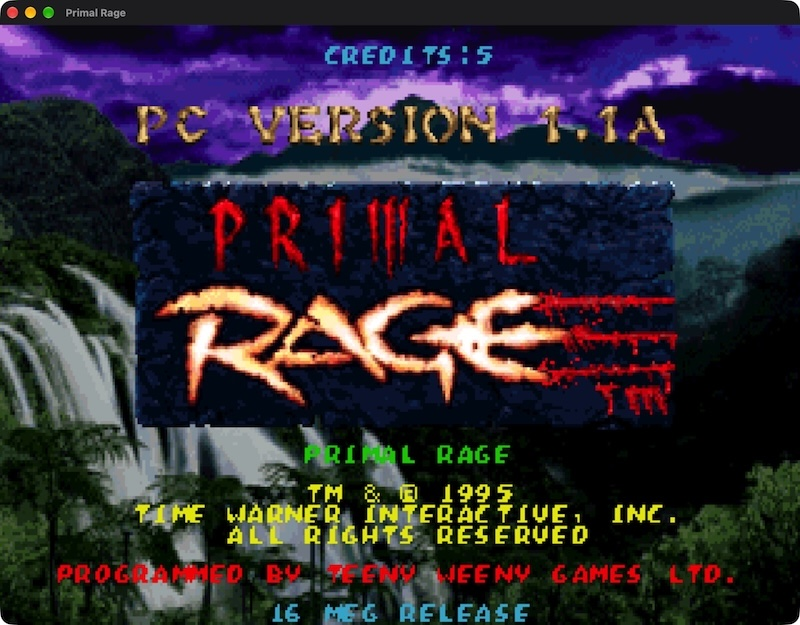

# Primal Rage (DOS, 1995) — Reverse Engineering 66%



Reverse engineering of **Primal Rage**'s PC/DOS release (Time Warner
Interactive / Probe Software / Teeny Weeny Games, 1995), targeting `PRAGE.EXE`
and the `S16*.GRA` graphics set.

It is a **32-bit protected-mode WATCOM C/C++32 program** shipped as a
**Microsoft DOS/4GW *bound* Linear Executable (LE)**. There is no 16-bit real
mode game code: everything interesting lives in two LE objects (code + data).

## Game assets

The original game files are **not included** in this repository and are
required to build, run, or reverse-engineer anything here. Download them (e.g.
from [myabandonware](https://www.myabandonware.com/game/primal-rage-2vr)) and
place them under `data/game/C/` (`PRAGE.EXE`, `INDEX`, `S16*.GRA`, sound
drivers). `data/` is git-ignored and read-only — the tools and tests never
write to it.

## Status

`PRAGE.EXE` (~1350 functions) and its `S16*.GRA` graphics set are fully
decompiled (`docs/FORMATS.md`, `port/decomp/`). The SDL3 port reimplements the
engine in C over a flat `mem[]` at the original addresses (`port/PORTING.md`)
and covers the whole game — boot, title, attract cycles, front end, service
menu, character select, one- and two-player matches, the win path, the ending,
and the game-over/high-score flows. Two claims back that:

- **Porting — 66% raw, 100% portable.** 799 of the original's 1203 real
  functions have a ported, header-commented counterpart in `port/src/` (see
  `AGENTS.md` for how that figure is computed). The 404 that are not are not
  porting targets: 53 are host-owned or deferred (`tools/port_classification.txt`,
  each with its evidence) and 351 are WATCOM libc / DOS/4GW runtime code (at or
  above `0x5D000`, served by the host libc). Excluding them, **100%** (759 of
  759) of the portable functions are ported. The last 12 were the input sampler
  and its keyboard/game-port readers (the host input truth phase); the 16 before
  them the storage layer (settings, high scores and audit counters kept in a save
  file) and the run clock that times them (track S).
- **Verification — differential.** `make diff-verify` runs the original's own
  bytes in unicorn against the port's C functions from the same image,
  comparing every changed byte, the return register, the ordered calls (with
  the memory changed so far at each) and the block coverage:
  **1031/1031 functions VERIFIED; 14983/14983 mutants detected**, with **813 of
  the 844 rows that have callees closed** (the 187 with none are counted apart);
  806 of those 813 rest on full rows and 31 stay open (by blocker, in
  `AGENTS.md`). C3g closed the
  callee-row frontier at 322 rows; track D rowed every ported function the
  callee scan never reached (751 of 759 have a row after its sixth wave, tracks
  S, I, N, H, F, G and the host input truth phase — 739 a full one (`0x51ED8`
  with one declared difference), and
  12 a row that runs the original under code pokes, leaves reachable blocks out
  or declares a terminal difference: `0x2CADC`, `game_loop`, `0x1AFE8`,
  `0x1B084`, `0x1BE30`, `0x1C740`, `0x24C5C`, `0x2EA78`, `0x2EA74`, `0x2EA68`,
  `0x1B544`, `0x2EA30`; the other 8 are named gaps, none is open; records
  `2026-10-11-reverse-d-derivations.md` and `2026-10-14-reverse-g-derivations.md`).
  The 2026-10-22 pixel-and-proof closure plan added 12 rows for game code whose
  callees were already VERIFIED — `0x5D812`/`0x28D68`, the fighter callbacks
  `0x3E484`/`0x29D04`/`0x3E4C4`, the actor entrances `0x24568`/`0x40CB0`/`0x24804`,
  the menu/loop/memset entries `0x2CB74`/`0x4F5C8`/`0x61A70` and the `+0x10` hook
  `0x3A6D4` (the spec's `0x3D0BC` is alignment padding, not a function) — and 28
  of the rows that were open on those callees closed (59 open → 31), moving the
  counter to 844 rows with callees, 813 closed and 806 full. The counter's
  "ported functions with no row" clause now measures the frontier from the
  repo's own tables: 45 `FN_` ported-unrowed, the declared portable 8 (5
  registry-visible + 3 header-shape exceptions) plus 37 runtime. The
  differential rows have found 172 raw-over-port corrections (track D; 174
  program-wide including track N's two, `PROGRESS.md:1034`). The E2 triage's
  remaining rows are the 231 table-driven span-writers — not ported one by one
  (decision D2: the port blits a span as one routine) — and 2 classified
  host-owned/deferred callbacks (`0x1BDF4`, `0x10604`).

Byte-exact oracles gate the rendering and timing: the Smacker logo, title,
attract, front end and demo fight, the service menu, and every captured
gameplay scenario are compared against the original's own captured frames.
The detailed, continuously-updated status — what's ported, what's verified,
and every named gap with its evidence — is in
**[`docs/PROGRESS.md`](docs/PROGRESS.md)**; the frame loop and pixel path are
in `port/spec/game_flow.md`.

## Layout

| Path | What |
|---|---|
| `docs/PROGRESS.md` | Running status: what's ported, verified, and every named gap |
| `port/` | SDL3 port: `RE_GUIDE.md` (address model), `PORTING.md` (rules), `spec/game_flow.md` |
| `port/src/` | The port: `game/`, `platform/` (gfx, sprite, render, res, input, `audio/`), `mem.c`, `host.c` |
| `port/decomp/` | Ghidra decompilation + function/string/symbol indexes (`DECOMPILATION.md`) |
| `docs/FORMATS.md` | Decoded on-disk formats (LE layout, `INDEX`, `GRA`) |
| `docs/THIRD_PARTY_LICENSES.md` | Vendored third-party code and licences |
| `docs/superpowers/` | Sub-project specs, plans, derivation records and reports |
| `tools/` | RE/oracle toolbox: `le_info.py`, `gra_render.py`, `gra_extract.py`, `gen_symbols.py`, the comparison tools |
| `_tools/ghidra_scripts/` | Ghidra headless scripts used to produce the artefacts |
| `data/game/C/` | Installed game (git-ignored); `data/game/CD/RAGECD.ISO` is the original CD |
| `Makefile` | `make help` — PORT (`build`/`test`/`check`/`run`/`verify`) and RE targets |

## Toolchain

* **Ghidra 12.2** with the
  [`ghidra-lx-loader`](https://github.com/yetmorecode/ghidra-lx-loader)
  extension (LE/LX loader, DOS/4GW aware), at
  `~/ghidra_12.2_DEV/Extensions/Ghidra/ghidra-lx-loader` and
  `~/Library/ghidra/ghidra_12.2_DEV/Extensions/ghidra-lx-loader`. It maps
  object 0 to `0x10000` (code) and object 1 to `0x80000` (data) and applies the
  LE fixups, so no manual image extraction is needed.
* **JDK 25** (`temurin-25`) for Ghidra 12.2.
* **dosbox-x** for ground truth (memory layout, runtime behaviour, captures).
* Python 3 with `capstone` for ad-hoc disassembly and `Pillow` for
  `tools/gra_extract.py`.
* Python 3 with `unicorn` and `capstone` for the differential harness
  (`make diff-verify`; `pip install -r tools/requirements-diff.txt`). Without
  either, that step skips.

### Regenerate the decompilation

```bash
export JAVA_HOME=/Library/Java/JavaVirtualMachines/temurin-25.jdk/Contents/Home
G="$HOME/ghidra_12.2_DEV/support/analyzeHeadless"

# one-shot import + analysis (the loader auto-detects the LE)
$G _tools/ghidra_proj prage -import data/game/C/PRAGE.EXE -overwrite \
   -scriptPath _tools/ghidra_scripts

# make .object1 executable, create the entry function, export everything
$G _tools/ghidra_proj prage -process PRAGE.EXE \
   -scriptPath _tools/ghidra_scripts \
   -postScript FixupProgram.java \
   -postScript ExportDecomp.java port/decomp/prage.c 90 \
   -postScript ExportMeta.java port/decomp/
```

## Build and run

```bash
cmake -S port -B build && cmake --build build     # or: make build
./build/prageport --game-dir data/game/C          # windowed; ESC to quit
./build/prageport --game-dir data/game/C --check 60
```

The window opens at 1024x768 (4:3, the original's CRT aspect) and is
user-resizable; the 320x200 frame is scaled to fill it (nearest-neighbour, to
keep the pixels hard). This is host policy, not from the original — see the
`PORT:` note in `host.c`. The windowed run opens the audio device at the FM
core's native 49716 Hz stereo rate; if no device can be started it prints
SDL's reason and continues silently (there is no sound flag).
`SDL_AUDIODRIVER=dummy` exercises the open path on a headless machine.

`--check N` runs exactly N master-loop iterations with no window and no audio
device, writing `frame_NNNN.ppm` (RGB), `frame_NNNN.pal` (the DAC) and
`frame_NNNN.idx` (raw indices) per frame, and exits non-zero on an internal
assertion failure.

### Verify

```bash
PR_ORACLE_REQUIRED=1 ./build/run_tests            # or: make verify
```

`make verify` is the gate: a `--check 820` headless smoke run (crossing the
boot attract into the title), the oracle-required test suite, the restart
driver, every pixel and ratchet oracle (Smacker, title, attract, front end,
demo fight, attract cycle 2, K11 service menu, the gameplay captures), the
differential harness, the E2 triage check, the tool unit tests, and
`symbols.h` idempotence. The capture-based oracles are **git-ignored copies of
the game's own bytes**, so they skip when their capture is absent:
`PR_ORACLE_REQUIRED=1` turns that absence into a failure where the Makefile
marks the oracle required, and `make verify` sets it. The comparison model
(DOSBox captures run at 70.09 Hz while the game ticks at 60.05 Hz) treats a
capture frame as a byte-offset splice of two adjacent port frames; the
ratchets (`DEMO_FIGHT_MIN_FIRST`, `ATTRACT2_MIN_FIRST`, the `gp_*` pins) hold
the measured first unexplained frame and are raised as the port improves. Each
pin's provenance is in the `Makefile`.

Prerequisites for the full gate: `port/tests/ghidra_data.bin` (git-ignored;
`make re-oracle` regenerates it), `unicorn` and `capstone` for the differential
harness (`pip install -r tools/requirements-diff.txt`), and `data/game/C/CMOS`
absent or 2040 zero bytes (the `make verify` precondition). `make deps` checks
each one and warns when one is missing or wrong. The capture-based oracles skip without
their git-ignored captures.

To produce the title/attract captures yourself:

```bash
make title-pin                                   # pin the four measured behaviour sites into /tmp/pr_title_pin/PRAGE.EXE
make title-capture                               # drive the pinned original under DOSBox-X (data/title-captures/title)
make frontend-capture                            # the front-end region (data/title-captures/frontend)
make title-oracle attract-oracle frontend-oracle # compare
```

## Third-party

The FM synthesiser is vendored: **opal 2.0.3**, MIT
(`https://github.com/RealBitdancer/opal`, commit `7e829f33`); its synthesis core
is by Shayde/Reality (Reality Adlib Tracker 2), public domain. It lives at
`port/src/platform/audio/opl/` with its licence at `opl/LICENSE.opal.txt`; the
files are byte-identical to upstream apart from a provenance banner. See
`docs/THIRD_PARTY_LICENSES.md`.
