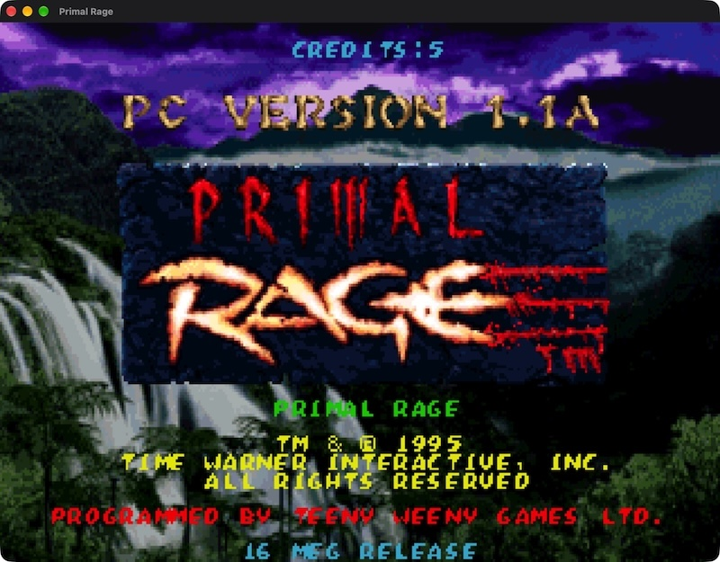
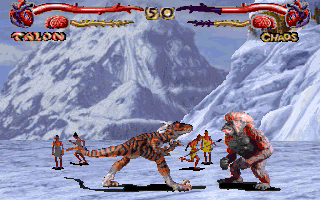

# Primal Rage (DOS, 1995) — fully playable SDL3 port





TALON vs CHAOS, a two-player round through the KO, rendered from the port's
replay of a DOSBox-X capture ([full 60 Hz clip](docs/gameplay.mp4)).

A reverse engineering of **Primal Rage**'s PC/DOS release (Time Warner
Interactive / Probe Software, 1995) and a native **SDL3 port** that runs the
original game data. The port reimplements `PRAGE.EXE`'s engine in C over a flat
`mem[]` that keeps every global at its original address.

**The game is complete and playable**: boot, intro movies, title and attract,
menus and service menu, character select, one- and two-player matches, every
game mode (including the volleyball and bowling secrets), continues, high
scores, saves, music and all seven endings.

## Quick start

The game files are **not included**. Get them (e.g. from
[myabandonware](https://www.myabandonware.com/game/primal-rage-2vr)) and put
`PRAGE.EXE`, `INDEX`, `S16*.GRA` and the sound drivers in `data/game/C/`.

```bash
make deps      # check the toolchain and game files
make build     # build the port (needs CMake and SDL3)
make run       # play (windowed; ESC quits)
```

Or directly: `./build/prageport --game-dir data/game/C`. The window opens at
1024x768 and is resizable; the 320x200 frame is scaled with nearest-neighbour
pixels. Audio is the original's FM music at 49716 Hz; if no audio device opens,
the game runs silent. In the windowed run, settings and high scores are saved to
SDL's per-user directory (or `--cmos FILE`).

## How complete is it?

| Measure | Figure | What it means |
|---|---|---|
| Game code ported | **759 / 759 (100%)** | Every function of the game's own code is reimplemented in C. |
| All functions in the executable | 798 / 1,203 (66%) | The other 405 are not game logic: the WATCOM C library, the DOS/4GW extender, the AIL sound library and DOS hardware glue (timer, joystick port, the movie-audio path the shipped movies never use), all replaced by the host's libc and SDL3. |
| Differential check | 1033 / 1033 functions | `make diff-verify` runs the original x86 bytes in an emulator and compares them with the C port, plus 14,993 mutants it must catch. |
| Captured ground truth | 46 / 47 captures | Frames, game state and OPL music registers recorded from the original under DOSBox-X and compared with the port. |

So **66%** is a count of all functions in the binary, most of which belong to
the 1995 compiler runtime and DOS drivers that a modern port does not need.
`python3 tools/port_progress.py` prints both figures and the full breakdown.

What is *not* proven is listed, with evidence, in the terminal claim register
[`docs/superpowers/specs/2026-10-30-final-claims.md`](docs/superpowers/specs/2026-10-30-final-claims.md)
(39 rows: 11 closed, 1 gated, 26 terminal, 1 declared). These are limits of
the proof (e.g. a fought arcade win was never captured, and audio is checked
as register writes rather than sound), not missing game features.
`docs/PROGRESS.md` holds the per-task history.

## Development

```bash
make help              # main targets; make help-all lists every target
make check frames=60   # headless run -> frames/frame_NNNN.ppm/.pal/.idx
make verify            # the full gate: tests, oracles, differential, audio
```

`make verify` needs `port/tests/ghidra_data.bin` (git-ignored; `make
re-oracle` regenerates it), `unicorn` and `capstone`
(`pip install -r tools/requirements-diff.txt`), the captures under `data/`,
and `data/game/C/CMOS` absent or 2040 zero bytes. Oracles skip when their
capture is missing. Contributor rules (address model, porting rules, how each
oracle is pinned) are in `AGENTS.md`, `port/RE_GUIDE.md` and `port/PORTING.md`.

The original is a 32-bit WATCOM C/C++ protected-mode program bound to DOS/4GW
as a Linear Executable: one code object at `0x10000`, one data object at
`0x80000`.

## Layout

| Path | What |
|---|---|
| `port/src/` | The port: `game/`, `platform/` (gfx, sprite, render, res, input, `audio/`), `mem.c`, `host.c`, `main.c` |
| `port/tests/` | Assertion suite and env-gated oracle drivers |
| `port/decomp/` | Ghidra decompilation and function/string/symbol indexes |
| `port/spec/` | Frame loop, state machine and pixel path |
| `tools/`, `_tools/ghidra_scripts/` | RE, capture and oracle tooling; Ghidra headless scripts |
| `docs/` | `PROGRESS.md`, `FORMATS.md` (LE, `INDEX`, `GRA`), specs/plans/records in `superpowers/` |
| `data/` | The game and its captures (git-ignored, read-only) |

## Toolchain

- CMake and SDL3 to build and play.
- Python 3 (`capstone`, `unicorn`, `Pillow`) for the tools and the gate.
- For RE work: Ghidra 12.2 with
  [`ghidra-lx-loader`](https://github.com/yetmorecode/ghidra-lx-loader),
  JDK 25, and `dosbox-x` for captures (see `port/RE_GUIDE.md`).

## Third-party

The FM synthesiser is **opal 2.0.3** (MIT,
`https://github.com/RealBitdancer/opal`, commit `7e829f33`; its core is by
Shayde/Reality, public domain), vendored byte-identical at
`port/src/platform/audio/opl/`. See `docs/THIRD_PARTY_LICENSES.md`.
